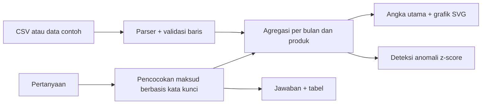

# FinSight

Dashboard penjualan dan persediaan untuk pemilik toko dan UKM. Impor data penjualan dari CSV, lihat pendapatan, laba, margin, dan stok menipis, ajukan pertanyaan atas data, lalu cetak laporan ke PDF.

**Demo langsung:** https://arilsaputra854.github.io/finsight/

Data contoh bersifat sintetis (toko kopi dan perlengkapan, 12 bulan, dibuat dengan generator acak berbenih tetap). Bukan data pelanggan.

## Yang bisa dicoba di demo

- Empat angka utama: pendapatan, laba kotor, margin, unit terjual.
- Grafik pendapatan dan laba per bulan, serta margin per produk dengan garis batas 15%.
- Tabel stok di bawah batas pesan ulang.
- Kotak "Tanya data": coba "Produk apa yang paling rugi bulan lalu?", "Produk terlaris", "Stok menipis", "Ada anomali?", "Tren pendapatan".
- Impor CSV sendiri (kolom `month,product,qty,revenue,cost`). Templat bisa diunduh dari halaman.
- Cetak atau simpan sebagai PDF lewat dialog cetak browser. Tombol dan kotak tanya otomatis disembunyikan di hasil cetak.

## Cara kerja



Anomali dihitung dari pendapatan bulanan tiap produk. Bulan dengan z-score mutlak di atas 2,2 ditandai.

## Demo vs produksi

| Bagian | Demo ini | Versi produksi |
|---|---|---|
| Pemahaman pertanyaan | Aturan kata kunci, bukan model bahasa | Gemini dengan function calling |
| Sumber data | CSV di memori browser | PostgreSQL |
| Eksekusi pertanyaan | Fungsi agregasi JavaScript | Kueri SQL berparameter yang ditentukan di server |
| Laporan PDF | Dialog cetak browser | Dibuat di server dengan templat tetap |

Di produksi model bahasa tidak boleh menulis SQL mentah terhadap data klien. Model hanya memilih fungsi dan parameter dari daftar yang diizinkan.

## Menjalankan lokal

```bash
git clone https://github.com/Arilsaputra854/finsight.git
cd finsight
npx serve .          # buka http://localhost:3000
npm test             # 5 test: seed, KPI, parser CSV, maksud pertanyaan, anomali
```

## Struktur

```
index.html, style.css, app.js   antarmuka laporan
src/core.js                     data contoh, parser CSV, agregasi, anomali, tanya data
test/core.test.mjs              test
DESIGN.md                       arah desain dan alasannya
```

## Batasan

- Setelah impor CSV, data stok dikosongkan karena CSV penjualan tidak memuat stok.
- "Tanya data" hanya mengenali lima jenis pertanyaan. Di luar itu ia menyatakan belum paham, bukan menebak.
- Laba kotor dihitung dari kolom `revenue` dikurangi `cost`. Biaya operasional tidak termasuk.

## Lisensi

MIT. Lihat [LICENSE](LICENSE).
